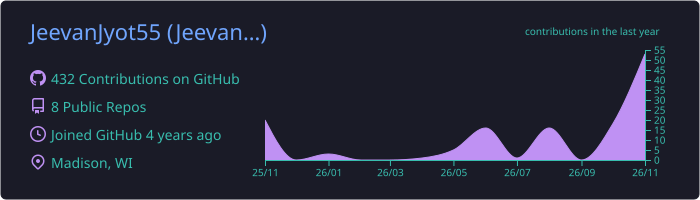
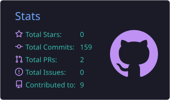
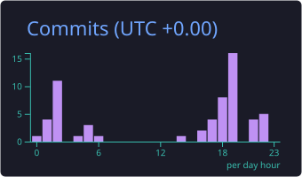
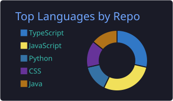
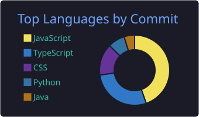

<!-- ═══════════════════════════ HEADER ═══════════════════════════ -->
<p align="center">
  
</p>

<p align="center">
  <a href="https://github.com/JeevanJyot55">
    
  </a>
</p>

<p align="center">
  <a href="https://jeevanjyot55.github.io"></a>
  <a href="https://www.linkedin.com/in/jeevanjyotsingh"></a>
  <a href="mailto:jeevanjsingh5125@gmail.com"></a>
  <a href="https://github.com/JeevanJyot55/neetcode-submissions"></a>
</p>


<!-- ═══════════════════════════ ABOUT ═══════════════════════════ -->
##  About Me

```python
class Jeevan:
    def __init__(self):
        self.role      = "SWE Intern @ Google (Summer 2026)"
        self.team      = "Google Photos — AI Mode"
        self.school    = "University of Wisconsin–Madison"
        self.majors    = ["Computer Science", "Economics"]
        self.year      = "Senior"
        self.focus     = ["AI / ML", "Full-Stack", "FinTech"]

    def motto(self):
        return "Code with purpose. Learn endlessly. Build things that last."

me = Jeevan()
```


- 🤖 Shipping **AI features at Google** on Google Photos' AI Mode
- 🔭 Currently building **[Park Madison](https://github.com/JeevanJyot55/park-madison)**, a parking finder for UW–Madison
- 🧠 Exploring **transformers for code translation** and **ML for finance**
- 📈 Where CS meets Econ: I love building tools that help people make better decisions
- ⚡ Fun fact: I rank my movies with an algorithm I wrote ([CineRank](https://github.com/JeevanJyot55/CineRank))


<!-- ═══════════════════════════ PROJECTS ═══════════════════════════ -->
## 🚀 Featured Projects

<table>
<tr>
<td width="50%" valign="top">

### 🔁 [Legacy Code Translator](https://github.com/JeevanJyot55/LegacyCodeTranslator)
**AI-powered C → Python translation.**
Fine-tunes a transformer (CodeT5) on a custom dataset of aligned C/Python pairs to modernize legacy code without manual rewrites.


</td>
<td width="50%" valign="top">

### 🎬 [CineRank](https://github.com/JeevanJyot55/CineRank)
**Rank movies by answering one question:**
> *"Which movie do you like better?"*

A binary-search-inspired algorithm places each movie in your ranked list in just a few comparisons.


</td>
</tr>
<tr>
<td width="50%" valign="top">

### 🔐 [authEncryption](https://github.com/JeevanJyot55/authEncryption)
**Secure, microservices-based authentication.**
Independent auth and customer services with **bcrypt** hashing, **JWT**-protected routes and a React frontend.


</td>
<td width="50%" valign="top">

### 📈 [OptiStocks](https://github.com/JeevanJyot55/OptiStocks)
**Data-driven stock recommendations.**
Scores tickers on momentum and RSI indicators to surface potential buys, with interactive charts.


</td>
</tr>
<tr>
<td width="50%" valign="top">

### ⏳ [FutureGram](https://github.com/ArshBansal64/FutureGram) <sub>*team project*</sub>
**A time-capsule social platform.**
Posts unlock only after a chosen future date: mindful sharing over dopamine-driven scrolling.


</td>
<td width="50%" valign="top">

### 🅿️ [Park Madison](https://github.com/JeevanJyot55/park-madison) <sub>🚧 *in progress*</sub>
**Find parking near UW–Madison & downtown.**
Interactive map with destination autocomplete, "locate me" and service-area overlays.


</td>
</tr>
</table>


<!-- ═══════════════════════════ TECH STACK ═══════════════════════════ -->
## ⚙️ Tech Arsenal

<div align="center">

| | |
|:--:|:--|
| **💻 Languages** |  |
| **🎨 Frontend** |  |
| **🛠️ Backend** |  |
| **🧠 AI / ML** |   |
| **🗄️ Data & Cloud** |  |
| **🔧 Tools** |  |

</div>

<details>
<summary><b>🤖 Deeper dive: AI / ML & backend specialties</b></summary>
<br>

| Area | Skills |
|---|---|
| **AI / ML** | NLP · Transformer Models · LLM Fine-Tuning · Tokenization · Seq2Seq · Prompt Engineering · GenAI (MetaGPT) |
| **Backend** | REST APIs · Microservices · Docker · CI/CD · Prisma ORM · AuthN / AuthZ |
| **Frontend** | React · Angular · SwiftUI · TypeScript UI Design |

</details>


<!-- ═══════════════════════════ STATS ═══════════════════════════ -->
## 📊 GitHub Analytics

<p align="center">
  
</p>

<p align="center">
  
  
</p>

<p align="center">
  
  
</p>

<p align="center">
  
</p>

<!-- Contribution snake: generated by .github/workflows/snake.yml -->
<p align="center">
  <picture>
    <source media="(prefers-color-scheme: dark)" srcset="https://raw.githubusercontent.com/JeevanJyot55/JeevanJyot55/output/github-snake-dark.svg" />
    <source media="(prefers-color-scheme: light)" srcset="https://raw.githubusercontent.com/JeevanJyot55/JeevanJyot55/output/github-snake.svg" />
    
  </picture>
</p>


<!-- ═══════════════════════════ CONNECT ═══════════════════════════ -->
## 🤝 Let's Connect

<p align="center">
  <i>Always happy to talk about AI, full-stack engineering, fintech or a good movie ranking.</i>
</p>

<p align="center">
  <a href="https://www.linkedin.com/in/jeevanjyotsingh"></a>
  <a href="mailto:jeevanjsingh5125@gmail.com"></a>
  <a href="https://jeevanjyot55.github.io"></a>
</p>

<!-- ═══════════════════════════ FOOTER ═══════════════════════════ -->
<p align="center">
  
</p>
